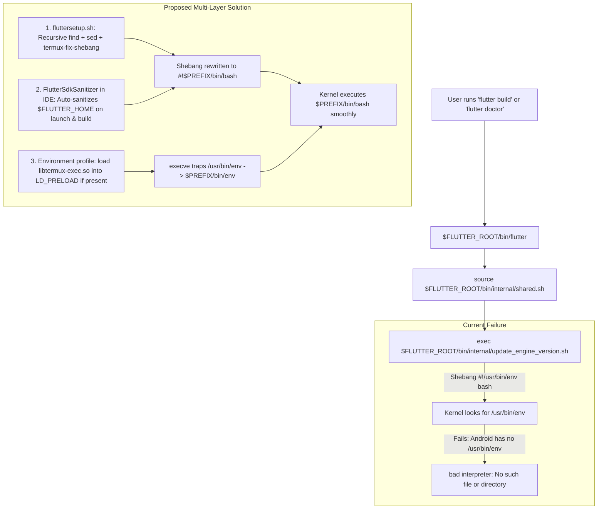

# Implementation Plan: Fix Flutter `/usr/bin/env: bad interpreter` on Android Code Studio

## Goal Description
When running Flutter commands (`flutter build apk` or `flutter doctor`) inside the on-device terminal or IDE build runner on Android Code Studio (`com.tom.rv2ide`), the execution aborts with:
```
/data/user/0/com.tom.rv2ide/files/usr/opt/flutter/bin/internal/shared.sh: /data/user/0/com.tom.rv2ide/files/usr/opt/flutter/bin/internal/update_engine_version.sh: /usr/bin/env: bad interpreter: No such file or directory
```

### Root Cause Analysis
1. **Missing FHS Root Paths on Android:** Android does not follow standard Linux FHS (Filesystem Hierarchy Standard). The root directory `/` is read-only, and `/usr/bin/env` does not exist. All Termux/RV2IDE userland binaries reside in `$PREFIX/bin` (e.g., `/data/user/0/com.tom.rv2ide/files/usr/bin/bash` and `/data/user/0/com.tom.rv2ide/files/usr/bin/env`).
2. **Incomplete Shebang Relocation in `fluttersetup.sh`:** The installer script previously only patched 3 specific files:
   ```bash
   for f in "$FLUTTER_ROOT/bin/flutter" "$FLUTTER_ROOT/bin/dart" "$FLUTTER_ROOT/bin/internal/shared.sh"; do
   ```
   When `bin/flutter` executes, it sources `shared.sh`. In turn, `shared.sh` invokes `update_engine_version.sh` (and subsequently `update_dart_sdk.sh` and others). Because `update_engine_version.sh` retains `#!/usr/bin/env bash`, the Linux kernel fails to find `/usr/bin/env` and aborts with `bad interpreter`.
3. **No Automatic Runtime Sanitization:** If Flutter is provisioned, restored via backup, or updated via `flutter upgrade`, scripts in `$FLUTTER_ROOT/bin/internal` remain unpatched unless repaired.

---

## User Review Required
> [!IMPORTANT]
> **Immediate Terminal One-Liner for Active Terminal Session:**
> If you are currently in the terminal on your Android device and want to unblock `flutter build apk` or `flutter doctor` immediately without waiting for a re-installation or rebuilding the app, run the following command in your RV2IDE terminal:
> ```bash
> PREFIX="${PREFIX:-/data/user/0/com.tom.rv2ide/files/usr}"
> FLUTTER_ROOT="${FLUTTER_ROOT:-$PREFIX/opt/flutter}"
> 
> # Fix shebangs and Termux prefix on all Flutter bin scripts
> find "$FLUTTER_ROOT/bin" -type f -exec sed -i -E \
>   -e "s|^#!\s*(/usr)?/bin/(env\s+)?bash|#!$PREFIX/bin/bash|g" \
>   -e "s|^#!\s*(/usr)?/bin/(env\s+)?sh|#!$PREFIX/bin/sh|g" \
>   -e "s|/data/data/com.termux/files/usr|$PREFIX|g" {} + 2>/dev/null
> 
> chmod +x "$FLUTTER_ROOT/bin/"* "$FLUTTER_ROOT/bin/internal/"* 2>/dev/null
> ```
> Once executed, `flutter doctor` and `flutter build apk` will immediately execute without the bad interpreter error.

---

## Architecture Flow



---

## Proposed Changes

### Component 1: Setup Scripts (`fluttersetup` & `fluttersetup.sh`)

#### [MODIFY] [fluttersetup.sh](file:///C:/Users/roni2/Downloads/Github-Projects/android-code-studio/termux/application/src/main/assets/data/common/arm64/fluttersetup.sh)
#### [MODIFY] [fluttersetup](file:///C:/Users/roni2/Downloads/Github-Projects/android-code-studio/termux/application/src/main/assets/data/common/arm64/fluttersetup)

1. **Step 4 (Dependencies):** Add `termux-exec` to the list of core packages to install if missing.
2. **Step 8 (Path & Shebang Relocation):**
   - Replace the narrow 3-file `for` loop with a recursive scan over all scripts in `$FLUTTER_ROOT/bin`, `$FLUTTER_ROOT/bin/internal`, and any `.sh` scripts in `$FLUTTER_ROOT/packages`.
   - Use `termux-fix-shebang` if available in `$PREFIX/bin`.
   - Strip CRLF carriage returns (`\r$`).
   - Rewrite `#!/usr/bin/env bash`, `#!/bin/bash`, `#!/usr/bin/bash` -> `#!$PREFIX/bin/bash`.
   - Rewrite `#!/usr/bin/env sh`, `#!/bin/sh` -> `#!$PREFIX/bin/sh`.
   - Replace legacy Termux prefix (`/data/data/com.termux/files/usr`) with dynamic `$PREFIX`.
   - Ensure executable permissions (`chmod +x`) on all files in `bin/` and `bin/internal/`.
3. **Step 10 (Environment Profile):**
   - In `$PREFIX/etc/profile.d/flutter.sh`, add `libtermux-exec.so` to `LD_PRELOAD` if `libtermux-exec.so` exists in `$PREFIX/lib`.
4. **Step 11 (Verification):**
   - Provide clear feedback if verification fails rather than swallowing errors silently with `|| true`.

---

### Component 2: Core Utility & In-App Auto-Sanitization (`:core:common`)

#### [NEW] [FlutterSdkSanitizer.kt](file:///C:/Users/roni2/Downloads/Github-Projects/android-code-studio/core/common/src/main/java/com/tom/rv2ide/utils/FlutterSdkSanitizer.kt)
Create a dedicated sanitizer utility in `:core:common`:
- Scans `$FLUTTER_HOME/bin` and `$FLUTTER_HOME/bin/internal`.
- Inspects script headers without reading huge binaries (skips files > 2MB like Dart binaries).
- Rewrites shebangs matching `/usr/bin/env` or `/bin/` to `$PREFIX/bin/bash` or `$PREFIX/bin/sh`.
- Cleans CRLF line endings.
- Relocates old Termux package prefixes.
- Sets `file.setExecutable(true, false)`.

#### [MODIFY] [Environment.java](file:///C:/Users/roni2/Downloads/Github-Projects/android-code-studio/core/common/src/main/java/com/tom/rv2ide/utils/Environment.java)
- Call `FlutterSdkSanitizer.sanitize(FLUTTER_HOME, PREFIX)` during environment initialization when `FLUTTER_HOME.exists()`.
- Add `libtermux-exec.so` to `LD_PRELOAD` in `putEnvironment()` if it exists in `$PREFIX/lib/libtermux-exec.so`.

---

### Component 3: Flutter Module Integration (`:flutter`)

#### [MODIFY] [FlutterProjectHelper.kt](file:///C:/Users/roni2/Downloads/Github-Projects/android-code-studio/flutter/src/main/java/com/tom/rv2ide/flutter/project/FlutterProjectHelper.kt)
- In `configureProjectForAndroidCS(projectDir: File)`, invoke `FlutterSdkSanitizer.sanitize()` to ensure that when a project is opened or prepared, the toolchain scripts are guaranteed to be executable.

#### [MODIFY] [FlutterBuildManager.kt](file:///C:/Users/roni2/Downloads/Github-Projects/android-code-studio/flutter/src/main/java/com/tom/rv2ide/flutter/service/FlutterBuildManager.kt)
- In `startBuild()`, run `FlutterSdkSanitizer.sanitize()` before launching the build process to guard against broken shebangs after external updates.

---

### Component 4: Documentation & Companion Scripts

#### [MODIFY] [decrypted_idesetup_arm64.sh](file:///C:/Users/roni2/Downloads/Github-Projects/android-code-studio/docs/idesetup/decrypted_idesetup_arm64.sh)
#### [MODIFY] [idesetup.sh](file:///C:/Users/roni2/Downloads/Github-Projects/android-code-studio/termux/application/src/main/assets/data/common/arm64/idesetup.sh)
#### [MODIFY] [idesetup](file:///C:/Users/roni2/Downloads/Github-Projects/android-code-studio/termux/application/src/main/assets/data/common/arm64/idesetup)
- Synchronize shebang sanitization checks and flags across `idesetup` scripts.

---

## Verification Plan

### Automated Tests
1. **Unit Test for Sanitizer:** Create `FlutterSdkSanitizerTest.kt` to verify that:
   - Scripts starting with `#!/usr/bin/env bash` are rewritten to `#!$PREFIX/bin/bash`.
   - Scripts with Windows `\r\n` line endings are normalized to Unix `\n`.
   - Legacy prefix paths are updated to current `$PREFIX`.
   - Binary files (e.g. mock binary bytes) are not corrupted or modified.
   - Executable permissions are applied.

### Manual Verification
1. **Terminal Command Verification:**
   Run the quick fix one-liner in the RV2IDE terminal emulator:
   ```bash
   find "$PREFIX/opt/flutter/bin" -type f -exec sed -i -E "s|^#!\s*(/usr)?/bin/(env\s+)?bash|#!$PREFIX/bin/bash|g" {} +
   chmod +x "$PREFIX/opt/flutter/bin/"* "$PREFIX/opt/flutter/bin/internal/"*
   ```
2. Verify by running:
   ```bash
   flutter doctor
   flutter build apk --release --target-platform android-arm64 --verbose
   ```
   Check that `update_engine_version.sh` executes smoothly without `/usr/bin/env: bad interpreter`.
3. Run `fluttersetup.sh --reinstall` to verify clean provisioning with automatic recursive shebang patching.
